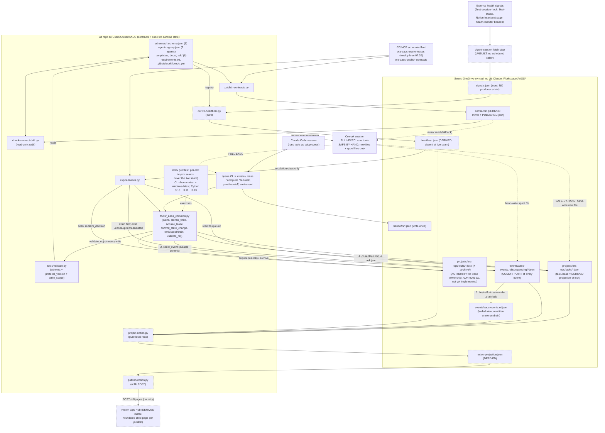
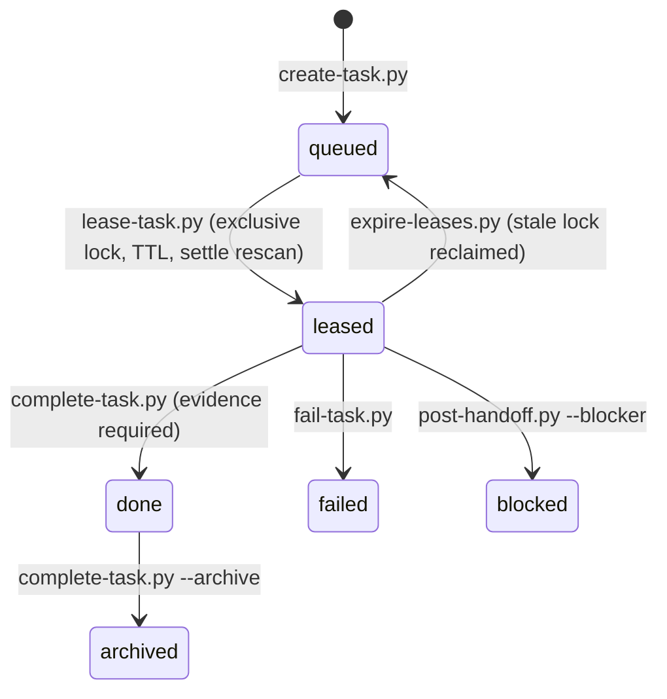

# AAOS — Agent-to-Agent Operating Substrate

## 1. What this actually is

AAOS is a **filesystem-based task queue and handoff protocol** that lets two Claude surfaces — a local Claude Code CLI session and a cloud Claude Cowork session — coordinate work at Oxford Realty Advisors without a server, message bus, or database. There is no running process, no daemon, and no network listener anywhere in this repo: "coordination" happens entirely through JSON files (tasks, handoffs, locks, an append-only event log) written to a shared OneDrive-synced folder (`Claude_Workspace\AAOS\`, referred to in the code/docs as "the seam"), plus a set of Python CLI scripts that read and atomically rewrite those files under a lease/lock discipline. Git (this repo, `C:\Users\Owner\AAOS\`) holds only the source of truth for the *contracts* — five JSON Schemas, a static two-entry agent registry, docs, templates, examples, tests, CI config, and the tooling itself — deliberately kept outside OneDrive to avoid `.git`-in-a-synced-folder corruption risk. A separate `publish-contracts.py` script copies (mirrors) those contracts into the seam so a Cowork session without git access can still read them. So: this is not a multi-agent runtime, an orchestrator, or a network protocol — it is a small, disciplined **shared-file locking/queueing library** (atomic write-rename, exclusive-create locks, lease TTLs, fail-closed conflict handling) wrapped in 13 single-purpose CLI scripts, with 267 unit/integration tests (`python -m unittest discover -s tests -p "test_*.py"`; all 267 passed locally on 2026-10-03, and the suite runs in GitHub Actions CI on Python 3.11 and 3.13) and an unusually extensive documentation/design-review trail (4 gate review records plus the Phase 1 design review and capability map covering gates 0-5, and 6 ADRs) for a codebase of this size. Docs describe v1.0 as feature-complete against its own deliverables manifest. The one item that manifest lists as open at v1.0 (a live round-trip showing a real Cowork session can read/write the seam) has since been evidenced in the live seam: a handoff authored by `cowork` (`h-cowork-seam-ack-e7c490`, posted 2026-07-10) answers `t-cowork-seam-confirm`, and that task was leased, completed and archived by `claude-code` on 2026-08-16. Cowork's side remains a carefully-written bootstrap runbook (`docs/COWORK-BOOTSTRAP.md`); nothing in this repo invokes Cowork automatically.

## 2. Architecture / data flow


<!-- diagram-verified: 2026-10-28 against origin/main f8f038a (dashed = designed/built but not running: no scheduled caller or no producer) -->

**Reading the diagram:** there is no coordinator process, no message broker, and no agent runtime loop — the flowchart is deliberately flat. "Coordination" is two independent CLI invocations (one per surface, at different times) reading and atomically rewriting the same small set of JSON files under a lease/lock discipline, plus a derived heartbeat/Notion-projection layer that is read-only and never itself a source of truth. The one genuinely live network call anywhere in this repo is `publish-notion.py`'s POST to the Notion API (stdlib `urllib`, no new dependency) — everything upstream of it, including `project-notion.py`'s payload build and `derive-heartbeat.py`'s projection, stays pure local-file computation, and a publish failure there is never treated as a queue failure. Two components have an external trigger, both on ORA's CC/MCP scheduler fleet rather than manual one-offs: `expire-leases.py` runs unattended as `ora-aaos-expire-leases` (weekly, Mondays 07:20 ET) and `publish-contracts.py` as `ora-aaos-publish-contracts`. The heartbeat/Notion-projection chain (`derive-heartbeat.py` → `project-notion.py` → `publish-notion.py`) is built and tested but has no scheduled caller: as of 2026-10-03 the live seam holds no `heartbeat.json`, `signals.json`, or `notion-projection.json`, so that half of the diagram shows the designed flow, not a running one. In the diagram, `signals.json` is the heartbeat chain's input and has no producer (the agent-session fetch step is UNBUILT); the spool file in `events/aaos-events.ndjson.pending/` — not the NDJSON — is each event's durable commit point; and the lock file is the lease-ownership authority while `task.lease` is only a projection of it (ADR-0006, not yet implemented in code). Four further diagrams (task lifecycle sequence, event commit/drain pipeline, lease authority vs projection, derived projection chain) are in [`docs/DIAGRAMS.md`](docs/DIAGRAMS.md).

### Task lifecycle (state machine)

States are the `state` enum in `schemas/task.schema.json`; each arrow is labelled with the script in `tools/` that performs it. `in-progress` is in the enum but reserved: every consumer accepts it alongside `leased`, and no script sets it. `blocked` and `failed` have no outgoing transition in the scripts shown here.



Every transition commits its event (`TaskCreated`, `TaskLeased`, `Completed`, `Failed`, `Blocked`, `LeaseExpired`, `Archived`, ...) before the state file is renamed into place; the full event type enum is in `schemas/event.schema.json`.

## 3. Directory structure

```
AAOS/
├── agent-registry.json     Static roster of the 2 known agents (claude-code, cowork):
│                            capabilities, reachable_paths, write_scope, heartbeat_source.
├── schemas/                5 JSON Schema (draft 2020-12) contracts, each carrying protocol_version:
│   ├── agent-registry.schema.json
│   ├── task.schema.json        state machine: queued/leased/in-progress/blocked/done/failed/archived
│   ├── handoff.schema.json     write-once agent→agent transfer w/ artifact manifest + hashes
│   ├── event.schema.json       one record/line of the append-only NDJSON event log
│   └── heartbeat.schema.json   derived per-agent freshness projection
├── tools/                  All executable logic — Python 3, stdlib + one external dep (jsonschema).
│   ├── _aaos_common.py         shared library: atomic write-rename, 6-step lease-acquire protocol,
│   │                           commit_state_change/assert_lease_held, reclaim_decision/archive_lock,
│   │                           emit_event/spool_event/drain_event_spool. Everything else is a thin
│   │                           CLI wrapper around this module.
│   ├── validate.py              validate any AAOS state file against its inferred JSON Schema
│   ├── create-task.py           enqueue a new task
│   ├── lease-task.py            acquire an exclusive, time-boxed lease on a queued task
│   ├── complete-task.py         mark a leased task done (+ optional archive), evidence required
│   ├── fail-task.py             mark a leased task failed
│   ├── post-handoff.py          write a write-once handoff between two agents
│   ├── expire-leases.py         sweep locks/, reclaim stale leases (registered: ora-aaos-expire-leases,
│   │                            CC/MCP fleet since 2026-07-10; weekly since 2026-09-13)
│   ├── emit-event.py            thin CLI wrapper to append one event (non-idempotent by design)
│   ├── derive-heartbeat.py      pure projection: externally-fetched signals.json -> heartbeat.json
│   ├── project-notion.py        pure local read (tasks+events+heartbeat) -> a Notion-bound payload
│   ├── publish-contracts.py     copies schemas/docs/registry/templates from this git tree to the seam mirror
│   ├── publish-notion.py        POSTs project-notion.py's local payload to the Notion Ops Hub
│   │                            (stdlib urllib, NOTION_TOKEN env var, --dry-run supported)
│   └── check-contract-drift.py  read-only guard: has the seam mirror drifted from the git tree?
├── requirements.txt        dependency floor: jsonschema>=4.18
├── .github/workflows/ci.yml  GitHub Actions: runs the suite on push/PR to main (Python 3.10, 3.11, 3.13)
├── tests/                  unittest suite (current count and last-green date: see section 4, Setup & run)
│   ├── _tool_loader.py         shared helper for importing hyphenated tools/*.py files in tests
│   ├── test_aaos_common.py, test_queue_scripts.py, test_e2e_lifecycle.py,
│   │   test_event_log_concurrency.py, test_failure_injection_matrix.py (17 tests),
│   │   test_check_contract_drift.py, test_derive_heartbeat.py, test_project_notion.py,
│   │   test_publish_contracts.py, test_publish_notion.py, test_validate.py,
│   │   test_lifecycle_hardening.py
│   └── fixtures/
├── templates/              5 fill-in-the-blank templates (task, handoff JSON; ADR, gate-review,
│                            BUILD-STATE markdown) used when authoring new instances by hand.
├── examples/               2 hand-authored, schema-valid sample instances (task, handoff).
├── docs/                   Design/spec/process documentation — unusually extensive for the code size:
│   ├── AAOS-SPEC.md             the binding spec (purpose, architecture, state model, locking,
│   │                            event log, heartbeat derivation, failure semantics, extensibility)
│   ├── NON-GOALS.md             7 binding non-goals (no distributed exec, no message bus, no plugin
│   │                            marketplace, no parallel QC engine, no protocol-negotiation
│   │                            machinery, no second memory system, no second scheduler)
│   ├── CAPABILITY-MAP.md        Phase 0 REUSE/EXTEND/BUILD inventory against existing ORA infra
│   ├── COWORK-BOOTSTRAP.md      self-contained runbook a Cowork session follows to join AAOS,
│   │                            including a SAFE-BY-HAND fallback write protocol
│   ├── CODE-ADAPTER.md, MIGRATIONS.md, V2-BACKLOG.md, OPERATIONS.md (runbook: inspect queue,
│   │                            break a stuck lock, archive a task, roll back protocol version)
│   ├── PHASE1-DESIGN-REVIEW.md, PHASE3-DESIGN.md, PHASE4-DESIGN.md, PHASE5-DESIGN.md
│   ├── GATE2-REVIEW.md … GATE5-REVIEW.md    adversarial design/code review records per phase
│   ├── DELIVERABLES-MANIFEST.md self-graded checklist of the v1.0 build against its own spec
│   ├── _task-reports/, adr/     6 ADRs (architecture selection, transport mechanics, locking
│   │                            model, event-log relationship, heartbeat derivation, lease ownership
│   │                            authority) plus 0006-evidence-backstop-blind-spot.py, a demonstration
│   │                            script for ADR-0006
└── archive/                one retired script (_validate_all.py)
```

Dependencies are declared in `requirements.txt` (`jsonschema>=4.18`; `Draft202012Validator`, which `docs/COWORK-BOOTSTRAP.md` Probe X needs, landed in 4.18). There is no `pyproject.toml` or `setup.py`. The only non-stdlib import found in `tools/` is `jsonschema`; everything else is the Python 3 standard library.

## 4. Setup & run

There is no build step, package, or installed CLI entry point — every script is invoked directly with `python`.

**Prerequisites:**
- Python 3 (CI runs 3.10, 3.11 and 3.13; 3.10 is the interpreter inside Cowork's sandbox) with `jsonschema` installed (`pip install -r requirements.txt`; floor-pinned, no lockfile).
- The seam directory reachable at `C:/Users/Owner/OneDrive - Oxford Capital Partners/Claude_Workspace/AAOS/` (hardcoded default in `tools/_aaos_common.py`'s `DEFAULT_SEAM_ROOT`; overridable per-invocation with `--seam-root`).

**Run the test suite:**
```
python -m unittest discover -s tests -p "test_*.py"
```
(283 tests, all green on 2026-10-17 on Windows under Python 3.11 and 3.13, counted on this branch before the other open PRs merge — recounted with `python -m unittest discover -s tests -p "test_*.py"`: 283, OK. The same command runs in `.github/workflows/ci.yml`; CI is the live source of truth for the count.)

**Validate a state file against its schema:**
```
python tools/validate.py <path-to-json-file> [--schema-dir <dir>] [--schema <name>] [--registry <path>]
```

**Drive the queue end to end** (each command's exit codes are documented in that script's own docstring, e.g. 0=success, 1=validation/corrupt state/unexpected error (never a raw traceback), 2=usage error (incl. an invalid task/handoff id), 3=state conflict/DENIED, 4=lease lost/CONTESTED, 5=event-commit failure):
```
python tools/create-task.py --title "<str>" --accept "<str>" (--id t-<slug> | --slug <slug>) [--owner <agent>] [--priority {1,2,3}]
python tools/lease-task.py <task-id> --holder <agent> --session <str> [--ttl-min 45] [--skew-min 5] [--settle-sec 30]
python tools/complete-task.py <task-id> --holder <agent> --session <str> --evidence label=<l> ref=<r> [--archive]
python tools/fail-task.py <task-id> --holder <agent> --session <str> --reason "<str>"
python tools/post-handoff.py --id h-<slug> --task <task-id> --from <agent> --to <agent> --next-action "<str>" [--summary "<str>"] [--artifact path=<p>]*
python tools/emit-event.py --type <EventType> --actor <agent|system> [--task t-...] [--handoff h-...] [--detail "<str>"]
python tools/expire-leases.py [--dry-run]
```

**Derive/project (pure local computation, no network calls of their own):**
```
python tools/derive-heartbeat.py --signals <path|-> [--out <path>]
python tools/project-notion.py [--project ora-ops] [--out <path>]
```

**Publish / audit the contracts mirror:**
```
python tools/publish-contracts.py [--seam-root <dir>] [--source-commit <sha>]
python tools/check-contract-drift.py [--seam-root <dir>] [--source-commit <sha>]
```

**Publish the Notion projection** (the one live network call in this repo):
```
python tools/project-notion.py [--project ora-ops] [--out <path>]
python tools/publish-notion.py [--project ora-ops] [--in <path>] [--parent-page-id <id>] [--dry-run]
```
Requires `NOTION_TOKEN` in the environment unless `--dry-run`; POSTs a dated child page under the Notion Ops Hub (`32b6ecd8…`), matching the existing child-page convention (Daily Brief, Automation Health, Outbox QC, …) rather than a parallel database.

`tools/expire-leases.py` **is registered** on ORA's CC/MCP scheduled-task fleet as `ora-aaos-expire-leases` (live since 2026-07-10; cadence 6x→3x/day on 2026-07-16, →1x/day on 2026-08-05, →weekly on 2026-09-13; cron `20 7 * * 1`, Mondays 07:20 ET) — it runs unattended. The weekly cadence widens the worst-case stale-lock reclaim window to ~7 days; it was chosen because `locks/` has held no live lock and the event log no new event since 2026-08-16, and should revert to daily if the seam queue becomes active again. The live registry is the authority for this cron, not this file. The manual invocation above is only for out-of-cadence intervention (see `docs/OPERATIONS.md` §2).

## 5. Key modules / classes

| File | Purpose (one line) |
|---|---|
| `tools/_aaos_common.py` | Shared library every CLI script imports: atomic write-rename, path helpers, the 6-step lease-acquire protocol, event spool/drain, schema validation glue. Nothing else in `tools/` duplicates this logic. |
| `_aaos_common.LeaseOutcome` / `LeaseResult` | Enum + dataclass result of a lease attempt: ACQUIRED / DENIED / CONTESTED. |
| `_aaos_common.ReclaimDecision` | Result type for whether a stale lock is reclaimable, and its escalation classification (`ExpiredLapsed` vs `DeadAgent`). |
| `_aaos_common.acquire_lease()` | Implements the spec's 6-step lease protocol (stage lock, exclusive-create, 30s settle window, conflict rescan, fail-closed on ambiguity). |
| `_aaos_common.commit_state_change()` | The transactional core: stage new state, append its event, then rename into place — event-write failure aborts the whole operation. |
| `_aaos_common.assert_lease_held()` | Guard every mutating script calls before writing, to catch a lease lost mid-operation. |
| `_aaos_common.emit_event()` / `spool_event()` / `drain_event_spool()` | Append-only NDJSON event log writer with an `O_EXCL` drain-lock and a spool-file fallback for writers (like a SAFE-BY-HAND Cowork session) that can't safely append directly. |
| `_aaos_common.match_write_scope()` | The "colonization guard" — checks a handoff's artifact paths against the sender's declared `write_scope` in `agent-registry.json`. |
| `tools/validate.py` | CLI: infers the right schema from a filename/path convention, checks `protocol_version` major-version compatibility, then full JSON-Schema validation. |
| `tools/create-task.py`, `lease-task.py`, `complete-task.py`, `fail-task.py` | The task lifecycle CLIs; each is a thin wrapper around `_aaos_common` plus its own idempotency and exit-code rules (documented in-file). |
| `tools/post-handoff.py` | Writes a write-once `handoff.json`; validates before writing; can additionally flip a task to `blocked` if `--blocker` is given. |
| `tools/expire-leases.py` | The lease-sweep/reclamation script; hard-expiry-only trigger, heartbeat only affects escalation classification, never gates reclamation. |
| `tools/derive-heartbeat.py`, `project-notion.py` | Pure, side-effect-free projection scripts — read already-fetched signals or local seam files only; neither calls Notion or any MCP tool itself. `project-notion.py` writes its payload to `notion-projection.json`; the actual POST is `publish-notion.py`'s job (below), kept separate so this script stays testable without a network/token dependency. |
| `tools/publish-notion.py` | The live call site `project-notion.py`'s output used to be deferred "to a future agent-session" — now built. Stdlib `urllib` POST of the local projection payload to the Notion API as a dated child page under the Ops Hub (`32b6ecd8…`); `--dry-run` prints the request body without sending. Read-only against the local payload, write-only against Notion; never touches `tasks/`, `locks/`, or the event log — a publish failure is never a queue failure. |
| `tools/publish-contracts.py`, `check-contract-drift.py` | Mirror publisher (git tree → seam `contracts/`) and its independent byte-level drift auditor. |

## 6. Notes & gotchas

- **The event log is the one place with a documented, fixed concurrency bug.** `docs/GATE3-REVIEW.md` records a Critical finding — two near-simultaneous direct appends to `aaos-events.ndjson` could silently clobber each other's line — fixed by introducing the spool-file + `O_EXCL` drain-lock mechanism now in `_aaos_common.py`. `COWORK-BOOTSTRAP.md` §8 repeats, as a hard rule, "never append to `aaos-events.ndjson` directly, even if it looks like just adding a line." **Resolved (OI-270):** between 2026-09-10 and 2026-09-18 `tests/test_event_log_concurrency.py::test_concurrent_writers_lose_zero_events` failed intermittently on GitHub's Linux runners because a live drain lock was judged stale and stolen, losing events after fold. The fix (`fix(events): OI-270`, PR #8, merged to `main`) landed with green CI on the PR and on `main` (2026-09-18).
- **Lease reclamation is intentionally NOT gated on heartbeat freshness.** `AAOS-SPEC.md` §7 explains the reasoning explicitly: gating on the (coarse, up-to-16-hour) Cowork heartbeat could wedge the queue for hours holding a genuinely-expired lease. Reclamation triggers on hard expiry alone; heartbeat only decides whether the reclaim is escalated as `DeadAgent` vs. routine `ExpiredLapsed`. The spec also notes this section's wording was corrected mid-project (Phase 3) after contradicting an earlier ADR.
- **Notion is read-only and Derived, never authoritative**, specifically because the Notion API has no compare-and-swap/file-lock primitive AAOS's atomic-lease guarantees require — the project rejected a Notion-as-primary-store design (see `docs/adr/0001-architecture-selection.md`) purely on correctness grounds.
- **A Cowork session in `SAFE-BY-HAND` mode must never edit an existing shared file, ever** — including `_seam-probe.md`, which the bootstrap doc notes literally contains a stale, superseded instruction telling the reader to "append a confirmation line" to it; the bootstrap explicitly overrides that embedded instruction rather than following it.
- **`emit-event.py` is deliberately non-idempotent** — every invocation mints a new event; the code comments warn future maintainers not to "fix" this into a dedup primitive, since deduplication of logically-repeated events is the calling script's job, not the event layer's.
- **Line endings are normalized by `.gitattributes` (`* text=auto`).** A diff can still look larger than expected on a checkout made before that file landed.
- **The headline "v1.0 shipped" claim is self-graded.** `docs/DELIVERABLES-MANIFEST.md` states plainly that none of the six phase gates received explicit human (Gabriel) sign-off before the next phase began — each was presented and the project proceeded on the next message, a fact it flags consistently rather than treating as approval. Treat "v1.0 complete" as the project's own thorough self-assessment (267 tests green today, 173 at v1.0 per the manifest; 6 documented adversarial gate reviews, all findings independently re-verified), not as an externally ratified release.
- **Seam-confirmation gap closed, with a caveat:** `docs/DELIVERABLES-MANIFEST.md` still lists the live Cowork round-trip as a standing open item (it was written at v1.0). The live seam since shows a `cowork`-authored return handoff (2026-07-10) and `t-cowork-seam-confirm` archived (2026-08-16). Still queued in the live seam: `t-cowork-jsonschema-pin-952743` (Cowork's request about the jsonschema pin; `requirements.txt` now declares the floor).
