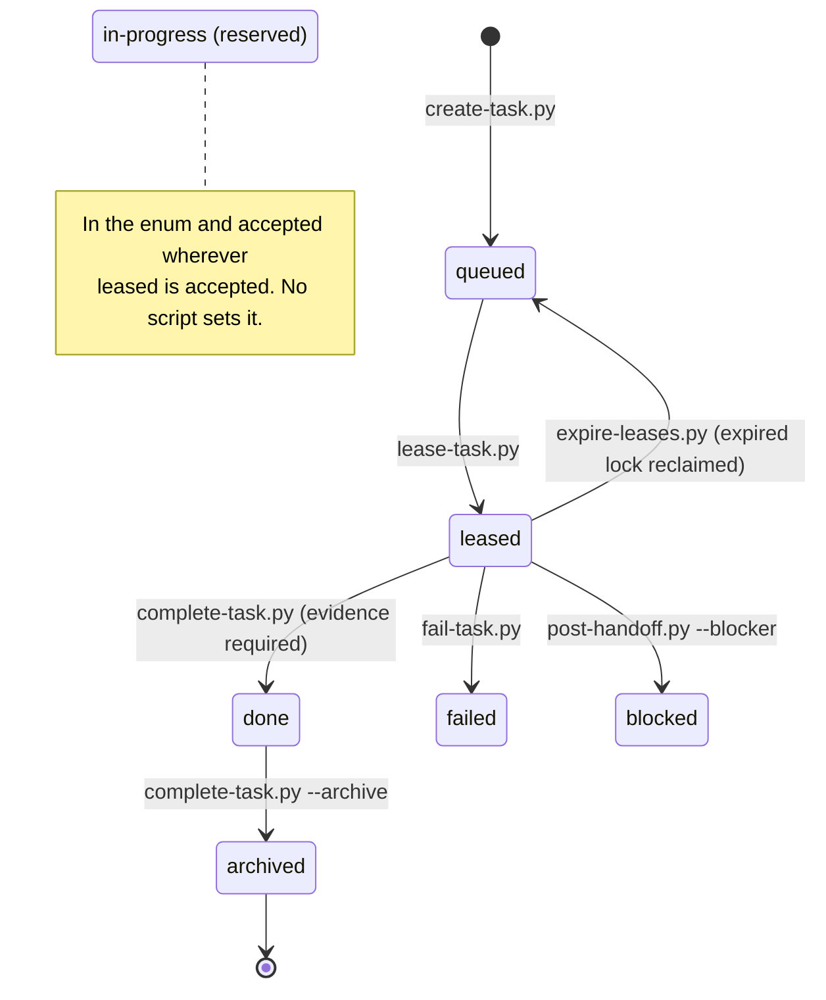
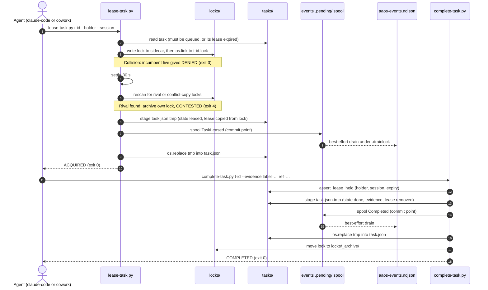

# AAOS: Agent-to-Agent Operating Substrate

**A filesystem task queue and handoff protocol that lets a local Claude Code session and a Claude Cowork session coordinate work through a shared folder. It needs no server, broker or database.**

[](https://github.com/ZeOoba/AAOS/actions/workflows/ci.yml)


> [!IMPORTANT]
> **Frozen since 2026-11-05 ([ADR-0007](docs/adr/0007-freeze.md)).** The live seam has had no task, lock or event activity since 2026-08-16, and both scheduled callers (the lease sweep and the contracts publisher) are disabled. CI now runs only on manual `workflow_dispatch`, so the badge shows the last run. AAOS is revived only through a new ADR, once the ADR-0007 trigger is met: a real cross-surface task appears at least twice in 30 days.

AAOS keeps all coordination state in JSON files: tasks, write-once handoffs, exclusive lock files and an append-only event log. They live in a OneDrive-synced folder called **the seam**. Every state change goes through one of 13 single-purpose Python CLI scripts that share one library, [`tools/_aaos_common.py`](tools/_aaos_common.py). That library supplies atomic write-then-rename, exclusive-create locks, lease TTLs with a settle-and-rescan step, and fail-closed handling of anything ambiguous. No process stays running and nothing listens on the network. The one network call in the repo is `publish-notion.py` posting a read-only status page.

This git repo holds the contracts and code: schemas, the agent registry, tools, tests and docs. It holds no runtime state. It sits outside OneDrive on purpose, because a `.git` directory inside a synced folder can be corrupted. `publish-contracts.py` copies the contracts into the seam so a Cowork session without git access can still read them.

## Contents

- [Core concepts](#core-concepts)
- [How it works](#how-it-works)
- [Repository layout](#repository-layout)
- [Quick start](#quick-start)
- [CLI reference](#cli-reference)
- [Exit codes](#exit-codes)
- [Schemas](#schemas)
- [Testing and CI](#testing-and-ci)
- [Configuration](#configuration)
- [Design decisions](#design-decisions)
- [Status and known limitations](#status-and-known-limitations)
- [Further reading](#further-reading)

## Core concepts

| Concept | What it is | Where it lives (relative to the seam root) | State class |
|---|---|---|---|
| **Seam** | The shared, OneDrive-synced folder holding all live coordination state. It contains no git. | seam root (see [Configuration](#configuration)) | n/a |
| **Task** | One unit of work: id `t-<slug>`, title, owner, priority 1 to 3, acceptance criteria, `state`, optional `lease`, and evidence once done. | `projects/<project>/tasks/<id>.json` | Source of Truth |
| **Lease** | A time-boxed right to work on a task. The default TTL is 45 min, with 5 min clock-skew grace and a 30 s settle window. `task.lease` is a copy of the lock's details. | the `lease` field in the task file | Derived (see ADR-0006) |
| **Lock** | The exclusive-create file that backs a lease, published atomically with `os.link`. A reclaimed lock is moved to `_archive/` and never deleted. | `projects/<project>/locks/<id>.lock` | Ephemeral |
| **Handoff** | A write-once transfer from one agent to another, with an artifact manifest (path, hash, bytes). Each artifact path is checked against the sender's `write_scope`. | `projects/<project>/handoffs/<id>.json` | Source of Truth |
| **Event** | One record of the append-only log. An event is committed once its spool file exists. Spool files are then folded into the NDJSON under a drain lock. | `projects/<project>/events/aaos-events.ndjson` and its `.pending/` spool | Source of Truth |
| **Agent registry** | The static list of agents (`claude-code`, `cowork`) with their capabilities, reachable paths, `write_scope` and heartbeat source. | [`agent-registry.json`](agent-registry.json) in git, mirrored to `contracts/` | Source of Truth |
| **Heartbeat** | A read-only, per-agent freshness view built from health signals that already exist. It only decides how a reclaim is classified. It never decides whether a lease can be reclaimed. | `heartbeat.json` | Derived |

The one seeded project is `ora-ops`. Every queue, lock, handoff and event path includes `projects/<project-id>/`.

## How it works

### Task lifecycle

The states are the `state` enum in [`schemas/task.schema.json`](schemas/task.schema.json). Each transition is labelled with the script that makes it.



`blocked` and `failed` have no outgoing transition in the current scripts. A `post-handoff.py` without `--blocker` posts the handoff and leaves the task state unchanged.

### Claim, lease, complete

Each mutating script follows the same transaction rule. It writes the new state to a temp file, commits the event to the spool, and only then renames the state file into place. If the event commit fails, the staged state is thrown away and the script exits 5.



`expire-leases.py` handles stale leases. It drains the spool first, then looks at each lock. A lock past `expires + skew` is reclaimed on expiry alone: it is archived, the task goes back to `queued`, and `LeaseExpired` is emitted. The holder's heartbeat only sets the classification. A `missed` or `unknown` heartbeat makes it `DeadAgent`, which also emits `Escalated`. A `fresh` or `stale` heartbeat makes it a routine `ExpiredLapsed`.

[`docs/DIAGRAMS.md`](docs/DIAGRAMS.md) has the full architecture flowchart and diagrams of the event commit and drain pipeline, lease authority versus its projection, and the derived projection chain.

## Repository layout

```
AAOS/
├── agent-registry.json        Static roster: claude-code, cowork (capabilities, write_scope, heartbeat source)
├── requirements.txt           jsonschema>=4.18 (the only third-party dependency)
├── schemas/                   5 JSON Schemas (draft 2020-12), each with protocol_version "1.0"
├── tools/                     _aaos_common.py shared library + 13 CLI scripts (all logic lives here)
├── tests/                     unittest suite (24 test modules), helpers, fixtures/
├── templates/                 task/handoff JSON templates; ADR, gate-review, BUILD-STATE markdown templates
├── examples/                  2 schema-valid samples (t-sample-001.json, h-sample-001.json)
├── docs/
│   ├── README.md              Index: which docs are live and which are history
│   ├── AAOS-SPEC.md           The protocol specification
│   ├── OPERATIONS.md          Runbook (inspect the queue, break a stuck lock, archive, roll back)
│   ├── COWORK-BOOTSTRAP.md    How a Cowork session joins, incl. the SAFE-BY-HAND write protocol
│   ├── CODE-ADAPTER.md, CAPABILITY-MAP.md, NON-GOALS.md, V2-BACKLOG.md, MIGRATIONS.md, DIAGRAMS.md
│   ├── adr/                   ADR-0001 to ADR-0007 (+ a demo script for ADR-0006)
│   ├── PHASE*/GATE*-REVIEW.md, DELIVERABLES-MANIFEST.md, _task-reports/, superpowers/  (history)
├── archive/                   One retired script (_validate_all.py)
└── .github/workflows/ci.yml   Test matrix + contracts round-trip job (manual dispatch only)
```

There is no package, `pyproject.toml` or installed entry point. Every script is run directly with `python tools/<script>.py`.

## Quick start

Prerequisites: Python 3.10 or newer (CI tests 3.10, 3.11 and 3.13) and `jsonschema>=4.18`.

```bash
pip install -r requirements.txt

# Run the suite. Tests use per-test temp seams and never touch the live seam.
python -m unittest discover -s tests -p "test_*.py"

# Try the full lifecycle against a throwaway seam (the seam root must already exist).
# On Windows PowerShell, set the variable with: $env:AAOS_SEAM_ROOT = "$PWD/.tmp-seam"
mkdir -p .tmp-seam
export AAOS_SEAM_ROOT="$PWD/.tmp-seam"

python tools/create-task.py --slug demo --title "Demo task" --accept "prints hello"
python tools/lease-task.py t-demo --holder claude-code --session s1 --settle-sec 0
python tools/complete-task.py t-demo --holder claude-code --session s1 --evidence label=log ref=stdout --archive

# Validate any state file against its inferred schema.
python tools/validate.py examples/t-sample-001.json
```

`--settle-sec 0` only shortens the demo. In real cross-surface use, keep the 30 s default. The settle-and-rescan step is how a OneDrive conflict copy is caught.

## CLI reference

Every queue script accepts `--project` (default `ora-ops`), `--seam-root` and `--now` (an ISO-8601 test hook). Run any script with `--help` to see its full argument list.

### Queue and lifecycle

| Script | Purpose | Key arguments |
|---|---|---|
| `create-task.py` | Add a new task in state `queued`. | `--title` (required), `--accept` (repeatable, at least one), `--id t-…` or `--slug`, `--owner` (default `unassigned`), `--priority {1,2,3}` (default 2), `--input label= ref= kind=`, `--suffix-timestamp` |
| `lease-task.py` | Take an exclusive, time-boxed lease using the 6-step protocol. | `task_id`, `--holder`, `--session` (required), `--ttl-min` (45), `--skew-min` (5), `--settle-sec` (30) |
| `complete-task.py` | Move a leased task to `done` (evidence required), and to `archived` if asked. | `task_id`, `--holder`, `--session`, `--evidence label= ref=` (at least one), `--archive` |
| `fail-task.py` | Move a leased task to `failed`. | `task_id`, `--holder`, `--session`, `--reason` (required), `--evidence` |
| `post-handoff.py` | Write a write-once handoff, checking artifact paths against `write_scope`. `--blocker` also moves the task to `blocked`. | `--id h-…`, `--task`, `--from`, `--to`, `--next-action` (required), `--summary` or `--summary-file`, `--artifact path=` (repeatable), `--blocker` (repeatable), `--suggested-next-owner`, `--holder`, `--session`, `--registry` |
| `emit-event.py` | Append one event. Not idempotent by design: every call creates a new event. | `--type`, `--actor`, `--task`, `--handoff`, `--lock`, `--escalation`, `--detail`, `--event-log-ref`, `--drain-only` |
| `expire-leases.py` | Sweep `locks/`: reclaim expired leases, flag corrupt locks, escalate dead agents. | `--dry-run` (writes nothing), `--skew-min` (5) |

### Validation and contracts

| Script | Purpose | Key arguments |
|---|---|---|
| `validate.py` | Validate a JSON or NDJSON state file. It works out the schema from the filename, checks the `protocol_version` major version, then checks `write_scope` for handoffs. | `path`, `--schema {agent-registry,event,handoff,heartbeat,task}`, `--schema-dir`, `--registry` |
| `publish-contracts.py` | Copy schemas, spec, registry and templates into the seam's `contracts/` mirror. `PUBLISHED.json` is written last. | `--seam-root`, `--source-commit` |
| `check-contract-drift.py` | Read-only, byte-level check that the seam mirror still matches the git tree. | `--seam-root`, `--source-commit` |

### Derived projections

| Script | Purpose | Key arguments |
|---|---|---|
| `derive-heartbeat.py` | Build `heartbeat.json` from a signals file that was already fetched. It only computes from local files. | `--signals <path or ->` (required), `--out`, `--now`, `--seam-root` |
| `project-notion.py` | Build the local Notion payload from tasks, events and the heartbeat. Writes `projects/<project>/notion-projection.json`. | `--project`, `--out`, `--now`, `--seam-root` |
| `publish-notion.py` | POST that payload to Notion as a dated child page, using stdlib `urllib`. Dry-run by default. `--live` needs `AAOS_NOTION_TOKEN` (the generic `NOTION_TOKEN` is not read), `AAOS_HASH_KEY` and, while frozen, `AAOS_UNFREEZE=1`. Task ids and titles are always sent as keyed `hmac:` tags. | `--project`, `--in`, `--parent-page-id`, `--seam-root`, `--dry-run`, `--live`, `--now` |

`_aaos_common.py` is a library, not a CLI. It provides path helpers, `atomic_write`, `acquire_lease`, `commit_state_change`, `assert_lease_held`, `reclaim_decision`, `emit_event`, `spool_event`, `drain_event_spool`, `read_events`, `match_write_scope` and `validate_obj`.

## Exit codes

The seven queue and lifecycle scripts share one exit-code contract. Unexpected exceptions become a one-line message and exit 1, never a raw traceback.

| Code | Meaning | Typical cause |
|---|---|---|
| `0` | Success, or an idempotent no-op | Normal completion, or re-running an identical command |
| `1` | Validation failure, corrupt state, or an unexpected error | Schema violation, unreadable lock or task |
| `2` | Usage error | Bad or missing argument, invalid task or handoff id, seam root missing |
| `3` | State conflict (DENIED) | Task not in the required state, or its lease is held by someone else |
| `4` | Lease lost (CONTESTED) | A rival lock or conflict copy found during settle, or the lease expired before commit |
| `5` | Event-commit failure | The spool write failed, so the state change was rolled back |

The other scripts use a smaller set. `validate.py`, `publish-contracts.py` and `derive-heartbeat.py` return 0, 1 (invalid) or 2 (usage). `check-contract-drift.py` returns 0 (clean), 1 (drift) or 2 (usage). `publish-notion.py` returns 0, 1 (the Notion API call failed) or 2 (usage, or a missing `--live` credential). `project-notion.py` returns 0 or 2.

## Schemas

All five are JSON Schema draft 2020-12 with `protocol_version` fixed at `"1.0"`. `validate.py` rejects a different major version and points to [`docs/MIGRATIONS.md`](docs/MIGRATIONS.md).

| Schema | Describes | Key fields |
|---|---|---|
| [`task.schema.json`](schemas/task.schema.json) | One task file | `state`: `queued`, `leased`, `in-progress`, `blocked`, `done`, `failed`, `archived`; `priority` 1 to 3; `lease` {holder, acquired, expires, session}; `evidence` |
| [`handoff.schema.json`](schemas/handoff.schema.json) | One write-once handoff | `from_agent`, `to_agent`, `task_ref`, `artifact_manifest`, `context_summary`, `required_next_action`, `blockers`, `suggested_next_owner` (advisory only) |
| [`event.schema.json`](schemas/event.schema.json) | One NDJSON event record | `type`: `TaskCreated`, `TaskLeased`, `LeaseRenewed`, `LeaseExpired`, `LeaseDenied`, `LeaseContested`, `HandoffPosted`, `Blocked`, `Completed`, `Failed`, `HeartbeatMissed`, `Escalated`, `Archived`; `actor`, `refs`, `detail` |
| [`heartbeat.schema.json`](schemas/heartbeat.schema.json) | The derived freshness view | Per agent: `last_run`, `source`, `status` (`fresh`, `stale`, `missed`, `unknown`), `threshold_hours` |
| [`agent-registry.schema.json`](schemas/agent-registry.schema.json) | The agent roster | `id`, `surface`, `capabilities`, `reachable_paths`, `invocation_method`, `write_scope`, `heartbeat_source`, `active` |

Lock files and drain-lock files have no schema. Their fields are checked in code.

## Testing and CI

```bash
python -m unittest discover -s tests -p "test_*.py"
```

**456 tests, all passing** (verified 2026-11-12 on Windows, Python 3.13, `jsonschema` 4.26, about 40 s). The suite covers:

- the queue scripts and an end-to-end lifecycle
- event-log concurrency and drain-lock interleaving
- a failure-injection matrix
- Windows filesystem semantics and ISO-8601 portability (including the Python 3.10 `Z`-suffix normaliser)
- bounds on CLI input
- the contract publisher and drift checker
- the heartbeat and Notion projections, including `publish-notion` redaction and its live gates
- the ADR-0007 freeze guard, plus a static test that every filesystem call in `tools/` goes through the guarded primitives

Five tests, covering four known defects, carry a strict `@known_defect` marker ([`tests/_known_defect.py`](tests/_known_defect.py)). Each one passes with a `KNOWN DEFECT` warning while the bug is still there, and fails once the bug is fixed, so the marker has to be removed (see [limitations](#status-and-known-limitations)).

[`.github/workflows/ci.yml`](.github/workflows/ci.yml) has two jobs:

| Job | What it runs |
|---|---|
| `test` | The full suite on `ubuntu-latest` and `windows-latest` × Python 3.10, 3.11 and 3.13. Windows legs are `continue-on-error`: they show NTFS semantics only, not OneDrive sync behaviour. |
| `contracts` | On Python 3.10: validates `agent-registry.json`, every `examples/*.json` and every `templates/*.template.json`. It then checks the tree is byte-identical to `HEAD`, publishes the contracts to a throwaway seam, and requires `check-contract-drift.py` to report clean. |

Under the freeze, CI runs only when someone triggers `workflow_dispatch`.

## Configuration

| Setting | How it is set | Notes |
|---|---|---|
| Seam root | `--seam-root`, then the `AAOS_SEAM_ROOT` env var, then `DEFAULT_SEAM_ROOT` in `tools/_aaos_common.py` | The built-in default is the operator's OneDrive-synced `Claude_Workspace/AAOS` folder. Off that machine, always set `--seam-root` or `AAOS_SEAM_ROOT`. Queue scripts fail with exit 2 if the root does not exist. |
| Project | `--project` (default `ora-ops`) | Must match `^[a-z][a-z0-9-]*$`. |
| `AAOS_NOTION_TOKEN`, `AAOS_HASH_KEY` | env vars | Used only by `publish-notion.py --live`; `AAOS_HASH_KEY` keys the `hmac:` redaction (16+ characters). Never commit them: `.gitignore` excludes `*.env*` and `*credentials*`. |
| `AAOS_UNFREEZE` | env var | While ADR-0007 stands, every tool refuses (exit 2, `FROZEN`) any path at or under the live seam unless this is `1`. Tests and copies of the seam are unaffected. |
| Notion parent page | `--parent-page-id` | Defaults to the operator's Ops Hub page. |
| Lease timing | `--ttl-min`, `--skew-min`, `--settle-sec` | Defaults are 45 min, 5 min and 30 s (AAOS-SPEC §7). Inputs are bounds-checked. |

Seam layout:

```
<seam-root>/
├── contracts/                 Derived mirror + PUBLISHED.json (publish-contracts.py)
├── heartbeat.json             Derived (derive-heartbeat.py)
└── projects/<project>/
    ├── tasks/<t-id>.json
    ├── handoffs/<h-id>.json
    ├── locks/<t-id>.lock        locks/_archive/
    ├── events/aaos-events.ndjson
    │   ├── aaos-events.ndjson.pending/    (spool: _drained/, _corrupt/)
    │   └── aaos-events.ndjson.drainlock
    └── notion-projection.json Derived (project-notion.py)
```

## Design decisions

The ADRs are binding. If an ADR and another doc disagree, the ADR wins.

| ADR | Decision |
|---|---|
| [0001](docs/adr/0001-architecture-selection.md) | A shared folder acts as the bus, and Notion is only a read-only mirror. Notion as the main store was rejected because its API has no compare-and-swap or lock primitive. |
| [0002](docs/adr/0002-transport-mechanics.md) | Every write is atomic (temp file then `os.replace`). Two trees: code in git outside OneDrive, state in the seam. Paths are namespaced by project. |
| [0003](docs/adr/0003-locking-model.md) | Lock format, the 45 min / 5 min / 30 s thresholds, and reclaim on expiry alone (heartbeat only classifies). Reclaimed locks are archived, never deleted. |
| [0004](docs/adr/0004-event-log-relationship.md) | AAOS keeps its own append-only NDJSON log. Only milestones are cross-referenced into the human event log. |
| [0005](docs/adr/0005-heartbeat-derivation.md) | The heartbeat is a pure view of existing health signals, with no new emitter. An unreadable signal gives `unknown`, which is never treated as fresh. |
| [0006](docs/adr/0006-lease-ownership-authority.md) | The lock file, not `task.lease`, is the sole authority for who owns a lease. This is ratified but only partly implemented; see [the demo script](docs/adr/0006-evidence-backstop-blind-spot.py). |
| [0007](docs/adr/0007-freeze.md) | Freeze: no amendments or refactors, CI on manual dispatch only, and the scheduled callers retired. Revival needs a new ADR. |

## Status and known limitations

- **Frozen.** Pending amendments AMD-0003, AMD-0004 and AMD-0006 are suspended. Two fix branches, `fix/t1-drain-non-object-ndjson` and `fix/t2-sweep-survives-drain-failure`, were left unmerged on the remote. The ADR-0007 addendum says retiring both scheduled tasks is ratified but not yet done (they are registered with `enabled:false`).
- **Pinned known defects** (each is a `@known_defect` test, still present on `main`):
  - **M01:** two processes taking over a stale drain lock can both hold it, and releasing it can delete a successor's live lock.
  - **M02:** `expire-leases.py` can requeue a lease that was renewed after the sweep judged it expired.
  - **M31:** `assert_lease_held` checks `task.lease` and ignores the lock file (ADR-0006 D1).
  - **M32:** when `os.link` is unavailable, the fallback create briefly exposes an empty lock file.
- **Lease renewal is not built.** No tool renews a lease or emits `LeaseRenewed`, so any job longer than the TTL can be reclaimed while it is still running.
- **The heartbeat and Notion chain has no caller.** `derive-heartbeat.py` → `project-notion.py` → `publish-notion.py` is built and tested, but nothing produces `signals.json` and nothing runs the chain on a schedule. Escalation rows in Notion (AAOS-SPEC §10) are also not built; an escalation exists only as an `Escalated` event.
- **OneDrive behaviour is not verified in CI.** The Windows CI legs show NTFS semantics only. Sync lag, conflict copies and Files-On-Demand have only been tested on the operating machine.
- **The v1.0 completion claim is self-graded** ([`docs/DELIVERABLES-MANIFEST.md`](docs/DELIVERABLES-MANIFEST.md)). No phase gate got an explicit human sign-off.

## Further reading

- [`docs/README.md`](docs/README.md): index of live versus historical documents
- [`docs/AAOS-SPEC.md`](docs/AAOS-SPEC.md): the protocol specification
- [`docs/OPERATIONS.md`](docs/OPERATIONS.md): runbook with a symptom-to-command table
- [`docs/COWORK-BOOTSTRAP.md`](docs/COWORK-BOOTSTRAP.md): how a Cowork session joins (FULL-EXEC and SAFE-BY-HAND modes)
- [`docs/NON-GOALS.md`](docs/NON-GOALS.md): what AAOS will not become (no message bus, no second scheduler, no plugin runtime)
