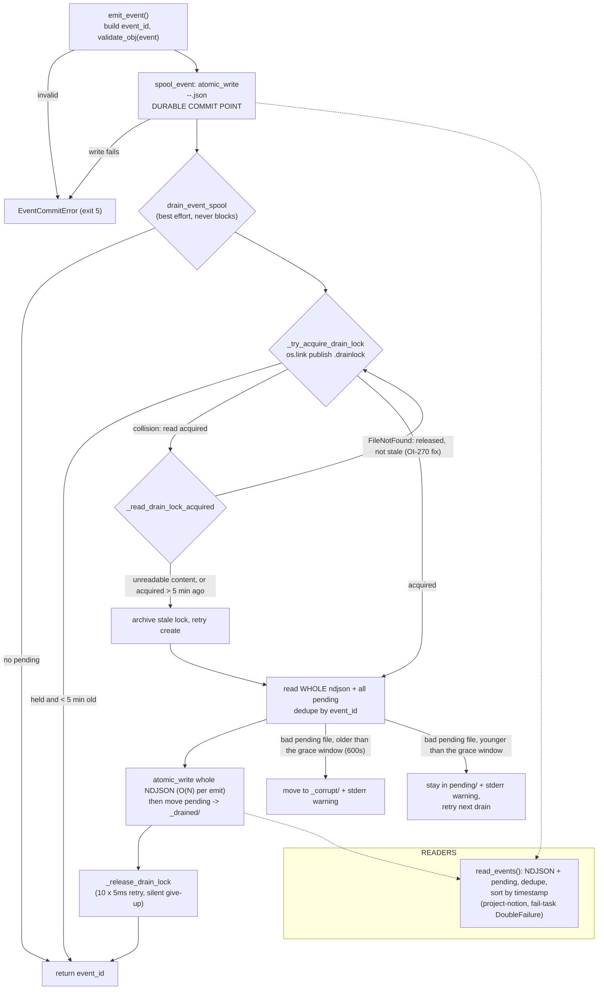
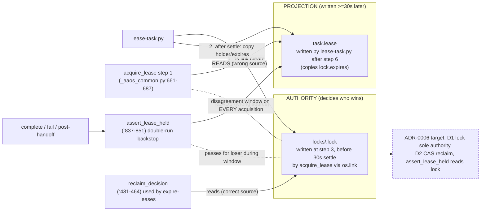
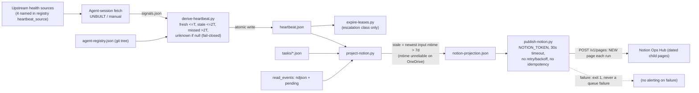

# AAOS diagrams

Companion to the architecture diagram in the README. Each diagram was checked against the code on `origin/main` 12ae2e4 (2026-10-03) on 2026-10-06. Where a defect is still open it is labelled. The lock/projection split is ADR-0006, which is not implemented.

## 1. Task lifecycle: write ordering and every exit

```mermaid
sequenceDiagram
    autonumber
    participant A as Agent (Code or Cowork)
    participant CT as create-task.py
    participant LT as lease-task.py
    participant C as _aaos_common
    participant L as locks/<id>.lock
    participant T as tasks/<id>.json
    participant S as events .pending/
    participant N as aaos-events.ndjson
    participant CP as complete-task.py
    participant EX as expire-leases.py (weekly)

    A->>CT: --title --accept
    CT->>T: atomic_write (exit 2/3 on usage/conflict)
    CT->>S: TaskCreated (commit_state_change)

    A->>LT: task_id --holder --session
    LT->>T: load (state=queued?)
    LT->>C: acquire_lease (45m TTL, 5m skew)
    C->>T: step 1: read task.lease (PROJECTION used for reclaim - ADR-0006 defect)
    C->>L: step 2-3: stage sidecar, os.link exclusive create
    alt link collides
        C->>L: read incumbent (short retry)
        C-->>LT: DENIED (exit 3) -> emit LeaseDenied
    end
    C->>C: step 4: sleep 30s settle (blocks the caller)
    C->>L: step 5: rescan for conflict copies
    alt conflict found
        C->>L: archive own lock
        C-->>LT: CONTESTED (exit 4) -> emit LeaseContested
    end
    C-->>LT: ACQUIRED
    LT->>T: stage tmp, validate, THEN emit TaskLeased, THEN os.replace
    LT->>S: TaskLeased (spool = commit point)
    S-->>N: drain (best effort, drain lock)
    Note over LT,L: if anything fails after step 3, lease-task archives its own lock (archive_lock_if_unchanged)

    A->>CP: task_id --evidence
    CP->>T: load; assert_lease_held reads task.lease only
    CP->>T: stage done state, validate
    CP->>S: Completed event
    CP->>T: os.replace
    CP->>L: archive_lock_after_commit (after the commit)

    Note over A,T: NO renew path: lease lasts 45 min then is reclaimable
    EX->>L: scan; reclaim_decision on lock expiry
    EX->>T: reset to queued, emit LeaseExpired (+Escalated if DeadAgent)
    EX->>L: archive; an expired lock whose task holds no lease is an ORPHAN LOCK, archived with no event
```

## 2. Event commit and drain pipeline

The spool file in `events/aaos-events.ndjson.pending/` is the durable commit point of an event. The NDJSON is a folded view written by a best-effort drain.



## 3. Lease authority (lock file) vs projection (`task.lease`)

This is the dual source of truth that ADR-0006 identifies as the root cause of the open lease-ownership defects (OI-265, OI-266). The target state in the dashed box is not implemented.



## 4. Derived projection chain (heartbeat to Notion)

`signals.json` has no producer, and the chain has no scheduled caller. The diagram shows the designed flow.


